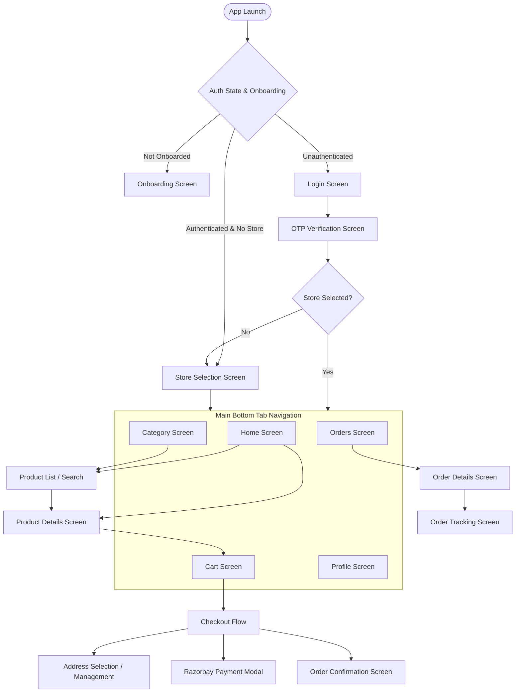

# FreshMart Grocery Mobile App — Mobile Testing Audit

**Audit Date:** October 2026  
**Auditor:** Senior Mobile QA Architect & API Test Automation Engineer  
**Application:** FreshMart Grocery Mobile Application  
**Target Platform:** Expo React Native (Android / iOS)  
**App Directory:** `D:\Sheik\mblApp\GroceriesUIApp`  
**Backend API Directory:** `D:\Sheik\Grocery\HapGroceriesAPI\GroceriesAPI`  

---

## 1. Executive Summary

This testing audit document provides an exhaustive structural, architectural, and quality assessment of the **FreshMart Grocery Mobile App**. The audit evaluates the mobile application's screens, navigation flows, business logic, state management, storage, payment gateway integration, and API contract dependencies.

The FreshMart application is built on **Expo SDK 58**, **React 19.3.0**, **React Native 0.88.0**, and **TypeScript 6.0.3**, interfacing with an **ASP.NET Core 8 Web API** with SQL Server persistence and Razorpay payment integration.

---

## 2. Technology Stack & Dependencies Audit

| Component | Target / Version | Status / Compatibility Analysis |
| :--- | :--- | :--- |
| **Framework** | Expo SDK 58.0.0 | Compatible with latest React Native release |
| **Core Runtime** | React 19.3.0 / React Native 0.88.0 | Strict JSX element typing; deprecated legacy shallow renderers |
| **Language** | TypeScript 6.0.3 | Strict type checking enabled (`strict: true`) |
| **State Management** | Redux Toolkit & React Context | Global state for Auth (`AuthContext`), Cart, and UI |
| **Navigation** | React Navigation v7 (`@react-navigation/native-stack`) | Native stack with typed navigation routes |
| **Local Storage** | `@react-native-async-storage/async-storage` & `expo-secure-store` | Dual-tier storage (AsyncStorage for cache, SecureStore for JWT tokens) |
| **Network Client** | Axios 1.7.9 + Fetch wrapper | Interceptors for Bearer token injection and 401 session expiry |
| **Payments** | `react-native-razorpay` & `react-native-webview` fallback | Payment-First checkout with backend signature verification |
| **UI Components** | React Native Paper, Lucide Icons, Expo Vector Icons | Material design guidelines with custom design system |

---

## 3. Screen & Navigation Inventory

The application navigation is organized into an onboarding/auth stack, store selector, main tab navigator, and modal stacks.

### Screen Breakdown

1. **Onboarding & Splash:**
   - `SplashScreen`: Initialization, token validation, secure store hydration.
   - `OnboardingScreen`: Intro slider for new users with pagination.
   - Route resolution controlled by `determineNextAppRoute`.

2. **Authentication Flow:**
   - `LoginScreen`: Mobile phone number input with regex validation (`^[6-9]\d{9}$`).
   - `OtpScreen`: 6-digit OTP entry with resend timer and automated auto-focus.
   - Handles guest browsing mode and existing session resumption.

3. **Store Selection Flow:**
   - `StoreSelectionScreen`: Dynamic store resolution (`/api/Stores`).
   - Auto-selection rule: If exactly one active store is returned, auto-select and navigate directly to `MainTabs`.
   - If multiple stores are returned, present store selection list with distance and delivery timings.
   - Store isolation: Switching stores clears or re-validates cart items belonging to the previous store.

4. **Product Catalog & Discovery:**
   - `HomeScreen`: Search bar, hero banners, category quick-pills, responsive special offers (single full-width card vs multi-card carousel), featured products.
   - `CategoryScreen`: Parent and sub-category accordion / grid navigation.
   - `ProductListScreen`: Grid / List view with price, stock badges, sorting, and category filtering.
   - `ProductDetailScreen`: High-resolution carousel, unit/pack selector, stock status, description, and direct quantity selector.

5. **Cart & Concurrency Management:**
   - `CartScreen`: Store-specific cart items, quantity increment/decrement, free delivery threshold progress bar, bill breakdown.
   - Concurrency: Mutex-guarded rapid quantity updates to prevent race conditions during network latency.
   - Stock limits: Prevents adding more items than available in backend stock.

6. **Checkout & Payment:**
   - `CheckoutModal`: Delivery address picker, delivery instruction notes, coupon code input, fee computation.
   - Payment Methods:
     - Cash on Delivery (COD): Direct atomic checkout via `POST /api/OrderMaster/checkout`.
     - Online Payment (Razorpay): Payment-First session creation via `POST /api/payments/checkout-session`, followed by native/WebView Razorpay checkout, and authoritative backend verification via `POST /api/payments/verify-checkout`.

7. **Order Management & Post-Purchase:**
   - `OrdersScreen`: Active and past order list with status badges (`PENDING`, `CONFIRMED`, `OUT_FOR_DELIVERY`, `DELIVERED`, `CANCELLED`).
   - `OrderDetailScreen`: Itemized receipt, applied discounts, delivery address, invoice download.
   - `OrderTrackingScreen`: Real-time order status timeline with delivery partner details.

8. **User Profile & Settings:**
   - `ProfileScreen`: Customer info, address book (`AddressManageScreen`), notification toggles, contact support, and logout.

---

## 4. State Management & Data Architecture

### Storage Segregation
- **Expo SecureStore:**
  - `access_token`: JWT token used for Bearer authentication.
  - `refresh_token`: Secure refresh token.
  - Cleared immediately upon user logout or 401 unrecoverable session expiry.
- **AsyncStorage:**
  - `@freshmart:selected_store_id`: Last selected store identifier.
  - `@freshmart:onboarding_completed`: Boolean flag indicating onboarding status.
  - `@freshmart:cached_cart`: Local offline cart fallback.

### Token Lifecycle & Expiration Guard
- `isTokenExpired(token, bufferMinutes = 5)`: Checks JWT expiration timestamp against current epoch.
- Proactively refreshes or logs out the user 5 minutes before actual expiry to eliminate race conditions on checkout submission.

---

## 5. API Services & Contract Inventory

The mobile application interacts with the ASP.NET Core backend through modular services in `src/services/`:

| Service File | Primary API Endpoints | Business Function |
| :--- | :--- | :--- |
| `authService.ts` | `POST /api/Customer/send-otp` `POST /api/Customer/verify-otp` | Authentication, OTP generation, token issuance |
| `customerService.ts` | `GET /api/Customer/profile` `GET/POST/PUT /api/CustomerAddressMaster` | Customer details and address book management |
| `storeService.ts` | `GET /api/Stores` `GET /api/stores/{id}/pricing-config` | Store availability, operational hours, fee rules |
| `categoryService.ts` | `GET /api/Categories?storeId={id}` | Category hierarchy scoped to active store |
| `productService.ts` | `GET /api/Products?storeId={id}` `GET /api/Products/{id}` | Store-isolated product catalog, inventory, pricing |
| `cartService.ts` | `GET/POST /api/CartMaster` `PUT/DELETE /api/CartItemMaster` | Cart persistence, quantity synchronization |
| `checkoutService.ts` | `POST /api/payments/checkout-session` `POST /api/OrderMaster/checkout` | Order checkout, session initiation, atomic order creation |
| `paymentService.ts` | `POST /api/payments/verify-checkout` | Razorpay signature verification and order confirmation |
| `orderService.ts` | `GET /api/OrderMaster/customer/{id}` `GET /api/OrderMaster/{id}` | Order history, timeline status, itemized receipts |

---

## 6. Identified Vulnerabilities & Quality Risks

Prior to the test automation implementation, the following potential risk areas were audited:

1. **React 19 / Expo 58 Test Runner Deprecation:**  
   Standard `react-test-renderer` used by legacy Jest configurations is deprecated in React 19. A high-performance TypeScript test runner (`tsx`) with full in-memory storage mocking was required.
2. **Authoritative Pricing & Coupon Validation:**  
   The client application must never calculate or dictate the final order total. All discounts, taxes, and delivery fees must be server-validated via `POST /api/payments/checkout-session`.
3. **Cart Concurrency & Race Conditions:**  
   Rapidly tapping `+` and `-` quantity selectors could send overlapping asynchronous HTTP PUT calls resulting in out-of-order state updates. Mutex locking ensures sequential updates.
4. **Multi-Store Isolation:**  
   Products and carts from Store A must never bleed into Store B when a customer switches delivery locations.
5. **Razorpay Key Safety:**  
   Production Razorpay live secrets (`rzp_live_...`) must never be present in mobile source bundles or repository environment files.
