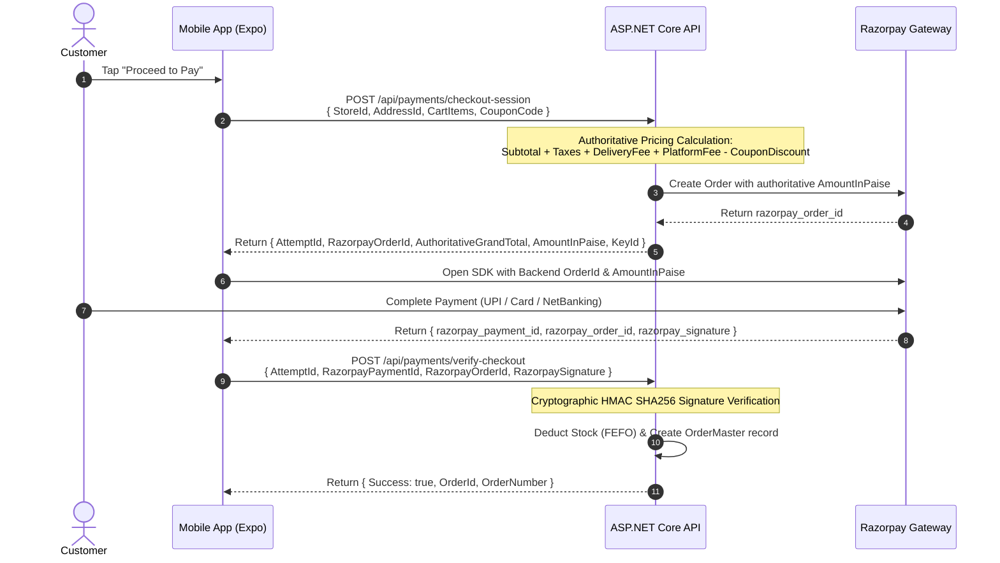

# FreshMart Mobile App — Test Data Strategy & Security Architecture

**Document Version:** 1.0  
**Author:** Senior Mobile QA Architect & API Test Automation Engineer  
**Date:** October 2026  
**Project:** FreshMart Grocery Mobile Application  

---

## 1. Test Data Management Strategy

To ensure safe, reproducible, and isolated test execution without contaminating production systems or risking data corruption, the following test data rules are established:

### 1.1 Synthetic Customer Profiles

All automated tests and staging environments must use designated synthetic test customer identities:

| Attribute | Sandbox / Test Value | Notes |
| :--- | :--- | :--- |
| **Test Phone Number 1** | `9876543210` | Primary test customer with complete profile and saved addresses |
| **Test Phone Number 2** | `9876543211` | Secondary test customer with empty address book and no past orders |
| **Test Customer ID** | `42` / `101` | Pre-seeded customer IDs in staging database |
| **OTP Code** | Mocked in unit/contract tests; configurable staging test OTP `123456` | OTP service supports test-phone bypass on non-production environments |
| **Test Email** | `qa.testuser@freshmart.local` | Synthetic domain preventing real external dispatch |

### 1.2 Test Delivery Addresses

Predefined test addresses representing various delivery zones:

- **Zone A (Within 3 km - Standard Delivery):**
  - Name: `John Doe (Home)`
  - Address: `123 Anna Salai, T. Nagar, Chennai`
  - Pincode: `600017`
  - Lat/Long: `13.0418, 80.2341`
- **Zone B (High-Rise Apartment with Delivery Instructions):**
  - Name: `Jane Doe (Work)`
  - Address: `Flat 4B, Green Towers, Velachery, Chennai`
  - Pincode: `600042`
  - Instructions: `Leave with security guard at Block B`

### 1.3 Test Stores & Catalog Data

- **Store 1 (Active, Urban Express):**
  - Store ID: `1`
  - Name: `FreshMart Express - T. Nagar`
  - Operational Hours: `06:00 - 22:00`
  - Delivery Fee: `₹40` for orders `< ₹500`; `₹0` (Free) for orders `>= ₹500`
  - Platform Fee: `₹5.00`
- **Store 2 (Active, Hypermarket):**
  - Store ID: `2`
  - Name: `FreshMart Super - Velachery`
- **Store 99 (Inactive Store):**
  - Store ID: `99`
  - Name: `FreshMart Closed Hub`
  - Status: `IsActive = false` (Used to test store availability guards)

---

## 2. Razorpay Gateway Security & Compliance

Payment processing is the most critical workflow in the application. In compliance with PCI-DSS guidelines and FreshMart security protocols, the following mandatory rules are enforced:

### 2.1 Live Key Prohibition in Client Bundles

> [!CAUTION]
> Under no circumstances may Razorpay Live Key IDs (`rzp_live_...`) or Razorpay Key Secrets be present in mobile source code, `.env` files, build manifests, or commit histories.

- **Automated Verification:**
  The unit test suite (`src/test/unitValidationAndAuth.test.ts` — TC-014) automatically inspects the configured Razorpay key and asserts:
  1. The key strictly begins with `rzp_test_`.
  2. The key does **not** begin with `rzp_live_`.
  3. The test suite fails immediately if any live key pattern is detected.

### 2.2 Payment-First Authoritative Architecture

The mobile application **never** calculates the payment amount for Razorpay:

### 2.3 Defense Against Client-Side Price Tampering

1. **Client GrandTotal is Non-Authoritative:**  
   If a client submits a modified GrandTotal (e.g., submitting `₹1.00` instead of `₹1,312.20`), the backend independently computes the total from database product prices and immediately rejects the request with HTTP 400 Bad Request:
   `"Submitted GrandTotal (1.00) does not match server authoritative GrandTotal (1312.20)."`
2. **Authoritative Coupon Discount:**  
   Coupons submitted by the client are re-validated on the server against expiry date, store eligibility, minimum cart value, and percentage limits. The client cannot inject an arbitrary discount amount.

---

## 3. Session & Credential Security

### 3.1 Dual-Tier Storage Architecture

| Data Classification | Storage Medium | Security Level | Data Stored |
| :--- | :--- | :--- | :--- |
| **Sensitive (Auth Credentials)** | `expo-secure-store` | Hardware-backed Keychain (iOS) / Keystore (Android) AES-256 | `access_token` (JWT), `refresh_token` |
| **Non-Sensitive (Preferences)** | `@react-native-async-storage/async-storage` | Unencrypted Key-Value Storage | `selectedStoreId`, `onboardingCompleted`, `recentSearches` |

### 3.2 5-Minute Proactive Expiration Buffer

To eliminate the risk of a user submitting a payment or order right as their JWT expires (which leads to cryptic 401 mid-transaction failures), the client implements `isTokenExpired(token, bufferMinutes = 5)`:

- When `currentTime >= (token.exp - 300 seconds)`:
  - The token is treated as expired immediately.
  - The client automatically triggers token refresh or guides the user to renew their session before entering the checkout tunnel.

### 3.3 HTTP 401 Global Interception & Safe Eviction

When an unrecoverable 401 Unauthorized response is received from any backend API:
1. Both `access_token` and `refresh_token` are wiped from `SecureStore`.
2. Global Redux and AuthContext states are reset to `unauthenticated`.
3. The navigation stack is cleanly reset to the `Login` screen with an informative alert ("Session expired. Please log in again.").

---

## 4. Production Protection Rules

To prevent accidental modification of production database records during manual or automated testing:

1. **Strict Staging Isolation:**  
   Automated tests point exclusively to localhost (`http://localhost:5000`) or designated staging API environments (`https://staging-api.freshmart.internal`). Never run automated tests against production endpoints (`https://api.freshmart.com`).
2. **No Destructive Database Commands:**  
   Automated tests must never execute `DROP TABLE`, `TRUNCATE`, or bulk `DELETE` scripts. Cleanup of test orders should occur via soft-delete flags or isolated test customer data scopes.
3. **Idempotency Tokens:**  
   All checkout requests generate a unique GUID `IdempotencyKey` stored in `PaymentCheckoutAttempt`. Resending the same payload due to network retries returns the existing checkout session rather than deducting stock or creating duplicate orders.
4. **Error Sanitization & PII Shielding:**  
   Backend stack traces, raw SQL queries, or internal database table names must never be displayed in mobile UI alert banners. The mobile app sanitizes API errors to human-readable summaries (e.g., "Unable to complete request. Please try again.").
