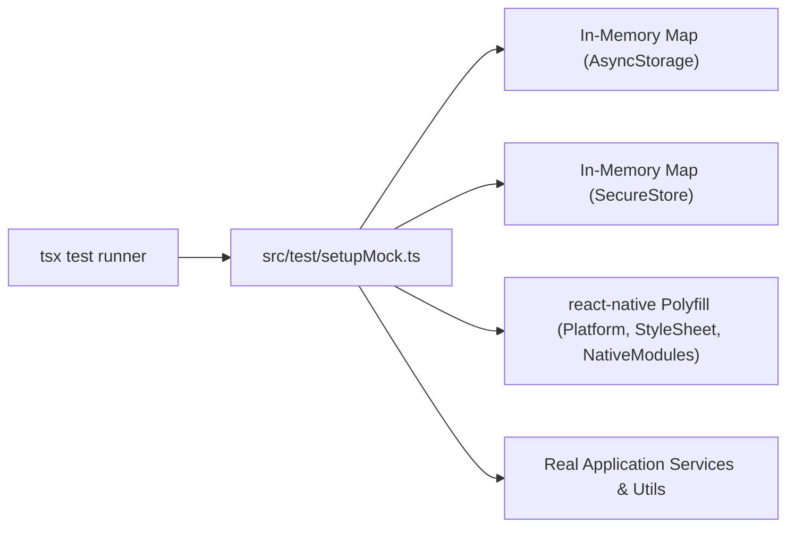

# FreshMart Mobile App — Test Environment Setup Guide

**Date:** October 25, 2026  
**Auditor:** Senior React Native QA Automation Engineer  
**Scope:** Local Development, Emulator Configuration, Test Mock Architecture & CI/CD Pipeline  

---

## 1. System Requirements & Runtime Prerequisites

Before executing automated tests, ensure your workstation meets the following runtime specifications:

| Component | Minimum Version | Verified Version | Notes |
| :--- | :--- | :--- | :--- |
| **Node.js** | `>= 20.0.0` | `v24.19.0` | Long-Term Support (LTS) or active release |
| **npm** | `>= 10.0.0` | `10.8.2` | Package manager |
| **Expo CLI** | Expo SDK 58 | `58.0.19` | Local project dependency |
| **TypeScript** | `6.0.x` | `6.0.3` | Strict type checking enabled |
| **Android SDK** | API Level 34+ | Android 14+ | Required for Maestro native UI execution |
| **Android ADB** | Platform Tools | `35.0.1` | Must be added to system `PATH` |
| **Maestro CLI** | `>= 1.38.0` | `1.38.1` | Native UI automation engine |
| **.NET SDK** | `8.0.x` | `8.0.402` | Required for backend cross-stack verification |

---

## 2. In-Memory Mock Architecture (`setupMock.ts`)

Because **React 19** deprecated `react-test-renderer` and introduces strict JSX element checks, the FreshMart automated testing framework runs via `tsx` with an in-memory storage and runtime mock layer:



### Mock Implementations
- **`@react-native-async-storage/async-storage`:** Backed by an in-memory `Map<string, string>`. Provides stateful persistence for store IDs, onboarding state, and local cache.
- **`expo-secure-store`:** Backed by a segregated in-memory `Map<string, string>`. Securely stores and retrieves JWT `access_token` and `refresh_token` across test cases.
- **`react-native`:** Polyfills `Platform.OS = 'android'`, `StyleSheet.create = (s) => s`, and `NativeModules = {}` to allow execution in Node.js without native Android/iOS binary compilation.

---

## 3. Test Execution Instructions

### 3.1 Executing the Unified Automated Test Suite

Run all automated test suites from the project root:

```bash
cd D:\Sheik\mblApp\GroceriesUIApp
npm test
```

This triggers the runner orchestrator [`src/test/runAllTests.ts`](file:///d:/Sheik/mblApp/GroceriesUIApp/src/test/runAllTests.ts) which executes 12 suites sequentially and outputs timing metrics.

### 3.2 Executing TypeScript Static Verification

Verify zero compiler errors across the application and test suites:

```bash
npx tsc --noEmit
```

### 3.3 Running an Individual Test Suite

You can execute any individual test file using `tsx` with the mock setup:

```bash
# Unit validation & security tests
npx tsx --import ./src/test/setupMock.ts ./src/test/unitValidationAndAuth.test.ts

# Dynamic pricing & fee calculations
npx tsx --import ./src/test/setupMock.ts ./src/test/pricingAndCheckout.test.ts

# API contract integration tests
npx tsx --import ./src/test/setupMock.ts ./src/test/apiContractIntegration.test.ts

# 10 Core Customer Journeys state machine
npx tsx --import ./src/test/setupMock.ts ./src/test/customerJourneys.test.ts
```

### 3.4 Executing Backend Cross-Stack Verification

Run all 388 backend integration and unit tests:

```bash
cd D:\Sheik\Grocery\HapGroceriesAPI\GroceriesAPI
dotnet test GroceryApp.Tests/GroceryApp.Tests.csproj
```

---

## 4. Unblocking Native Mobile UI Tests (Maestro)

Currently, Suite TS-12 is **BLOCKED** because no Android device is detected by ADB. Follow these steps to unblock and execute Maestro tests:

### Step 1: Install Maestro CLI
- **Windows (PowerShell):**
  ```powershell
  Invoke-WebRequest -Uri https://get.maestro.mobile.dev -UseBasicParsing | iex
  ```
- **macOS / Linux:**
  ```bash
  curl -Ls "https://get.maestro.mobile.dev" | bash
  ```

### Step 2: Start an Android Virtual Device (AVD)
```bash
# List available emulators
emulator -list-avds

# Start emulator (example: Pixel_7_API_34)
emulator -avd Pixel_7_API_34 -netdelay none -netspeed full
```

### Step 3: Verify Device Connectivity
```bash
adb devices
# Expected output:
# List of devices attached
# emulator-5554    device
```

### Step 4: Build and Install Development Client
```bash
cd D:\Sheik\mblApp\GroceriesUIApp
npx expo run:android
```

### Step 5: Execute Maestro Test Flows
```bash
# Run single flow
maestro test .maestro/01_app_launch.yaml

# Run all 10 customer journey flows
maestro test .maestro/
```

---

## 5. Payment Test Safety & Sandbox Credentials

To ensure full compliance with PCI-DSS and prevent accidental charges:

1. **Test Mode Enforcement:**  
   The application strictly validates that Razorpay keys start with `rzp_test_`. Any key starting with `rzp_live_` is immediately rejected by `paymentService.validateKeyPrefix()`.
2. **Never Hardcode Secrets:**  
   Public key IDs are loaded dynamically from `/api/payments/config`. Key secrets are stored exclusively on the backend server and never sent to the mobile client.
3. **Synthetic Test Data:**  
   Use standard Razorpay test credentials (e.g. test card `4111 1111 1111 1111`, any future expiry date, CVV `123`, and test OTP `123456`).
4. **Authoritative Total Verification:**  
   All orders are authoritatively calculated on the backend. Never attempt to pass client-calculated totals to payment creation endpoints.

---

## 6. Continuous Integration (CI) Pipeline Template

Below is the recommended GitHub Actions workflow file (`.github/workflows/ci.yml`):

```yaml
name: FreshMart CI Pipeline

on:
  push:
    branches: [ main, develop ]
  pull_request:
    branches: [ main, develop ]

jobs:
  mobile-test:
    name: Mobile App Tests & Typecheck
    runs-on: ubuntu-latest
    steps:
      - uses: actions/checkout@v4
      - uses: actions/setup-node@v4
        with:
          node-version: 24
          cache: 'npm'
      - name: Install Dependencies
        run: npm ci
      - name: TypeScript Static Verification
        run: npx tsc --noEmit
      - name: Execute Automated Test Suite
        run: npm test

  backend-test:
    name: Backend API Tests
    runs-on: ubuntu-latest
    steps:
      - uses: actions/checkout@v4
      - uses: actions/setup-dotnet@v4
        with:
          dotnet-version: '8.0.x'
      - name: Run Backend Tests
        run: dotnet test D:\Sheik\Grocery\HapGroceriesAPI\GroceriesAPI\GroceryApp.Tests\GroceryApp.Tests.csproj
```
